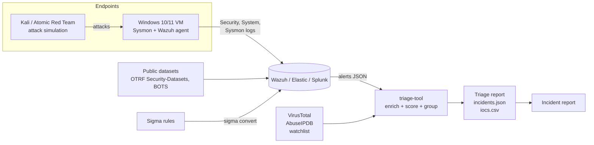

# SOC Detection Engineering & Incident Response Lab


[](https://github.com/mehedi-cryptic/soc_lab/actions/workflows/validate.yml)

**Author:** Md Hasan Bhuiyan

This is a hands-on Security Operations Center project. I wrote detection rules for real attacker
techniques, converted them to SIEM queries, built a Python tool that triages and enriches the
resulting alerts, and investigated a simulated intrusion from the first click to ransomware staging.

---

## What's inside

| Area | What I built | Where |
|---|---|---|
| **Detection engineering** | 19 Sigma rules (plus 1 correlation rule) covering 27 ATT&CK techniques across 12 of the 14 Enterprise tactics, each with false-positive notes and tuning guidance | [`detections/sigma/`](detections/sigma) |
| **SIEM queries** | Every rule converted to **Splunk SPL** and **Elastic Lucene / ES\|QL** | [`detections/queries/`](detections/queries) |
| **Coverage mapping** | Rule → technique → tactic → data source matrix, plus a tuning log | [`attack-mapping.md`](attack-mapping.md) |
| **Triage automation** | Python tool: parses alerts (generic or Wazuh), decodes obfuscated PowerShell, extracts IOCs, enriches with VirusTotal / AbuseIPDB, scores risk and groups alerts into prioritized incidents | [`triage-tool/`](triage-tool) |
| **Incident response** | Full investigation report of a phishing → credential theft → lateral movement → ransomware-staging intrusion | [`incident-reports/`](incident-reports) |
| **Lab build** | Wazuh + Sysmon + Atomic Red Team setup guide, plus public datasets for testing without a lab | [`lab-setup/`](lab-setup) |
| **CI** | GitHub Actions validates every Sigma rule and runs 35 unit tests on each push | [`.github/workflows/`](.github/workflows) |

## Architecture



## Detection coverage

| Tactic | Rules |
|---|---|
| Initial Access | Office app spawning a shell |
| Execution | Encoded PowerShell, WMI remote shell, PsExec service |
| Persistence | Suspicious scheduled task, new service in user-writable path, Run-key persistence |
| Privilege Escalation | New service in user-writable path |
| Defense Evasion | Security log cleared, certutil LOLBin abuse, Defender tampering |
| Credential Access | Brute force (correlation), LSASS handle access, comsvcs.dll MiniDump, Kerberoasting, DCSync |
| Discovery | Domain admin / trust / privilege enumeration |
| Lateral Movement | PsExec, WMI remote execution |
| Collection | Password-protected or staged archives (7-Zip, RAR, Compress-Archive) |
| Command and Control | certutil download |
| Exfiltration | Rclone / MEGAcmd upload to cloud storage |
| Impact | Shadow copy and backup deletion |

Reconnaissance and Resource Development are not covered. They happen before the attacker
reaches the network, so endpoint logs rarely show them.

Full matrix with data sources and tuning notes: [`attack-mapping.md`](attack-mapping.md).

## Quick start

```bash
git clone https://github.com/mehedi-cryptic/soc_lab.git
cd soc_lab

# 1. Validate the detection rules
pip install sigma-cli
sigma check detections/sigma

# 2. Run the triage tool on the sample intrusion (no API keys needed)
cd triage-tool
pip install -r requirements.txt
python triage.py samples/sample_alerts.json --offline --out reports/

# 3. Run the tests
python -m pytest -q
```

Sample output:

```
ID       PRI  SCORE  HOST          ALERTS  TACTICS
INC-001  P1   100    WS-FIN-07     9       initial-access > execution > persistence > ... > lateral-movement > command-and-control
INC-002  P1   100    SRV-FILE-01   4       execution > persistence > defense-evasion > lateral-movement > impact
INC-003  P2   75     RDP-JUMP-01   1       credential-access
INC-004  P4   20     WS-HR-02      1       persistence
```

The full generated report is in [`triage-tool/examples/sample_run/triage_report.md`](triage-tool/examples/sample_run/triage_report.md).

## Featured investigation

**[IR-2026-001: Phishing to Pre-Ransomware Staging](incident-reports/IR-2026-001-phishing-to-ransomware-staging.md)**

A macro-enabled invoice leads to encoded PowerShell, a certutil download, LSASS dumping with
`comsvcs.dll`, PsExec to the file server, and shadow-copy deletion, all within 51 minutes of the
first click. The report covers the timeline, IOCs, root cause and containment. It also covers a
**detection gap**: the LSASS-access rule filtered out `rundll32.exe` because it lives in System32,
and the report explains how I closed that gap.

## Skills demonstrated

- Writing and tuning detections with **Sigma**, and converting them for **Splunk** and **Elastic**
- Mapping detections to **MITRE ATT&CK** and tracking coverage gaps
- Windows logging: **Security** (4625, 4662, 4769, 1102), **System** (7045), **Sysmon** (1, 10, 13)
- Active Directory attacks: Kerberoasting, DCSync, credential dumping, lateral movement
- Alert triage, **IOC enrichment** with threat-intel APIs, and risk-based prioritization
- Incident response reporting: timeline reconstruction, scoping, containment, lessons learned
- **Python** automation with unit tests, and **CI** with GitHub Actions

## Repository layout

```
soc_lab/
├── detections/
│   ├── sigma/                     # source of truth: Sigma rules
│   └── queries/{splunk,elastic}/  # generated by scripts/convert_rules.sh
├── triage-tool/                   # Python alert triage + enrichment
│   ├── soctriage/                 # loader, iocs, enrich, scoring, incidents, report
│   ├── context/                   # asset inventory, privileged accounts, IOC watchlist
│   ├── samples/                   # sample alerts (generic + Wazuh format)
│   ├── examples/sample_run/       # example output
│   └── tests/
├── incident-reports/              # investigation write-ups + template
├── lab-setup/                     # how to build the lab
├── dashboards/                    # dashboard specs + screenshots
├── scripts/convert_rules.sh
└── attack-mapping.md
```

## Roadmap

- [x] Detection rules for every tactic from Initial Access to Impact
- [x] Splunk and Elastic query conversion
- [x] Triage and enrichment tool with tests and CI
- [x] Incident report for a full intrusion chain
- [ ] Validate each rule against Atomic Red Team in the home lab, with screenshots
- [ ] SOC overview dashboard (Wazuh / Splunk)
- [ ] Second investigation using Splunk BOTS v3
- [ ] Linux detections (SSH brute force, suspicious cron jobs)
- [ ] More rules: new local admin account (T1136.001), RDP enabled via registry (T1021.001)

## Disclaimer

All hostnames, users, IPs (RFC 5737 documentation ranges) and hashes in the sample data are
fictional. Attack simulations should only be run on systems you own.

## Contact

**Md Hasan Bhuiyan** · [LinkedIn](https://www.linkedin.com/in/md-hasan-bhuiyan-54b849192) · [GitHub](https://github.com/mehedi-cryptic)

## License

MIT, see [LICENSE](LICENSE).
