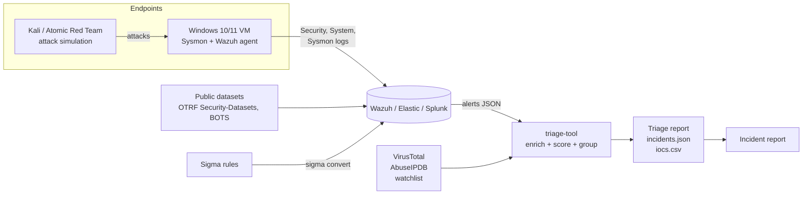

# SOC Detection Engineering & Incident Response Lab


A hands-on Security Operations Center project: I wrote detection rules for real attacker
techniques, converted them to SIEM queries, built a Python tool that triages and enriches the
resulting alerts, and investigated a simulated intrusion end to end.

> **Replace before publishing:** `YOUR_NAME` in the rules, the CI badge URL, and the screenshots
> in `dashboards/screenshots/`. See [Make it yours](#make-it-yours).

---

## What's inside

| Area | What I built | Where |
|---|---|---|
| **Detection engineering** | 14 Sigma rules (13 detections + 1 correlation) covering the full attack lifecycle, each with ATT&CK mapping, false-positive notes and tuning guidance | [`detections/sigma/`](detections/sigma) |
| **SIEM queries** | Every rule auto-converted to **Splunk SPL** and **Elastic Lucene / ES\|QL** | [`detections/queries/`](detections/queries) |
| **Coverage mapping** | Rule → technique → tactic → data source matrix, with known gaps | [`attack-mapping.md`](attack-mapping.md) |
| **Triage automation** | Python tool: parses alerts (generic or Wazuh), decodes obfuscated PowerShell, extracts IOCs, enriches with VirusTotal / AbuseIPDB, scores risk and groups alerts into prioritized incidents | [`triage-tool/`](triage-tool) |
| **Incident response** | Full investigation report of a phishing → credential theft → lateral movement → ransomware-precursor intrusion | [`incident-reports/`](incident-reports) |
| **Lab build** | Wazuh + Sysmon + Atomic Red Team setup guide, plus public datasets for people without a lab | [`lab-setup/`](lab-setup) |
| **CI** | GitHub Actions validates every Sigma rule and runs 35 unit tests on each push | [`.github/workflows/`](.github/workflows) |

## Architecture



## Detection coverage at a glance

| Tactic | Rules |
|---|---|
| Initial Access | Office app spawning a shell |
| Execution | Encoded PowerShell, WMI remote shell, PsExec service |
| Persistence | Suspicious scheduled task, new service in user-writable path, Run-key persistence |
| Defense Evasion | Security log cleared, certutil LOLBin abuse |
| Credential Access | Brute force (correlation), LSASS handle access, comsvcs.dll MiniDump |
| Discovery | Domain admin / trust / privilege enumeration |
| Lateral Movement | PsExec |
| Command and Control | certutil download |
| Impact | Shadow copy / backup deletion |

Full matrix with data sources and tuning notes: [`attack-mapping.md`](attack-mapping.md).

## Quick start

```bash
git clone https://github.com/<you>/soc-detection-lab.git
cd soc-detection-lab

# 1. Validate the detection rules
pip install sigma-cli
sigma check detections/sigma

# 2. Run the triage tool on the sample intrusion (no API keys needed)
cd triage-tool
pip install -r requirements.txt
python triage.py samples/sample_alerts.json --offline --out reports/

# 3. Run the tests
python -m pytest -q
```

Sample output:

```
ID       PRI  SCORE  HOST          ALERTS  TACTICS
INC-001  P1   100    WS-FIN-07     9       initial-access > execution > persistence > ... > lateral-movement > command-and-control
INC-002  P1   100    SRV-FILE-01   4       execution > persistence > defense-evasion > lateral-movement > impact
INC-003  P2   75     RDP-JUMP-01   1       credential-access
INC-004  P4   20     WS-HR-02      1       persistence
```

The full generated report is in [`triage-tool/examples/sample_run/triage_report.md`](triage-tool/examples/sample_run/triage_report.md).

## Featured investigation

**[IR-2026-001: Phishing to Pre-Ransomware Staging](incident-reports/IR-2026-001-phishing-to-ransomware-staging.md)**:
a macro-enabled invoice leads to encoded PowerShell, a certutil download, LSASS dumping with
`comsvcs.dll`, PsExec to the file server, and shadow-copy deletion 51 minutes after the first click.
The report covers the timeline, IOCs, root cause, containment, and a **detection gap** I found
(my LSASS-access rule filtered out `rundll32.exe` because it lives in System32) and how I fixed it.

## Skills demonstrated

- Writing and tuning detections with **Sigma**, and converting them for **Splunk** and **Elastic**
- Mapping detections to **MITRE ATT&CK** and identifying coverage gaps
- Windows logging: **Security** (4625, 1102), **System** (7045), **Sysmon** (1, 10, 13)
- Alert triage, **IOC enrichment** with threat-intel APIs, and risk-based prioritization
- Incident response reporting: timeline reconstruction, scoping, containment, lessons learned
- **Python** automation with tests, and **CI** with GitHub Actions

## Repository layout

```
soc-detection-lab/
├── detections/
│   ├── sigma/                 # source of truth: Sigma rules
│   └── queries/{splunk,elastic}/  # generated by scripts/convert_rules.sh
├── triage-tool/               # Python alert triage + enrichment
│   ├── soctriage/             # package: loader, iocs, enrich, scoring, incidents, report
│   ├── context/               # asset inventory, privileged accounts, IOC watchlist
│   ├── samples/               # sample alerts (generic + Wazuh format)
│   ├── examples/sample_run/   # committed example output
│   └── tests/
├── incident-reports/          # investigation write-ups + template
├── lab-setup/                 # how to build the lab
├── dashboards/                # dashboard specs + screenshots
├── scripts/convert_rules.sh
└── attack-mapping.md
```

## Make it yours

This repo is a starting point. To make it a genuine portfolio piece:

1. **Build the lab** in [`lab-setup/`](lab-setup) and run the Atomic Red Team tests listed there.
2. **Prove each rule fires.** Add a screenshot of a real hit per rule in `dashboards/screenshots/`
   and note the Atomic test ID in `attack-mapping.md`.
3. **Tune something.** Record one false positive you saw and the filter you added.
4. **Write your own investigation** with the [template](incident-reports/TEMPLATE.md) using
   Splunk BOTS v3 or an OTRF dataset.
5. Replace the placeholder author everywhere:
   ```bash
   grep -rl YOUR_NAME . | xargs sed -i 's/YOUR_NAME/Your Real Name/g'
   ```

## Disclaimer

All hostnames, users, IPs (RFC 5737 documentation ranges) and hashes in the sample data are
fictional. Run attack simulations only on systems you own.

## License

MIT, see [LICENSE](LICENSE).
